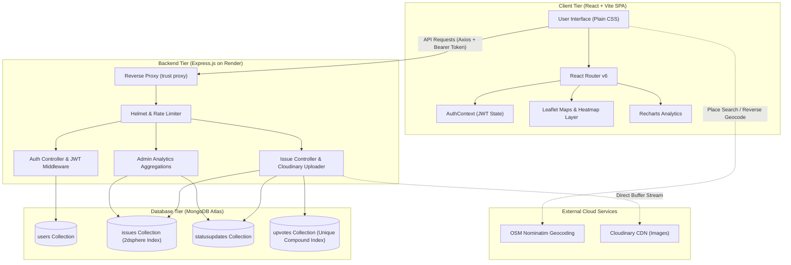
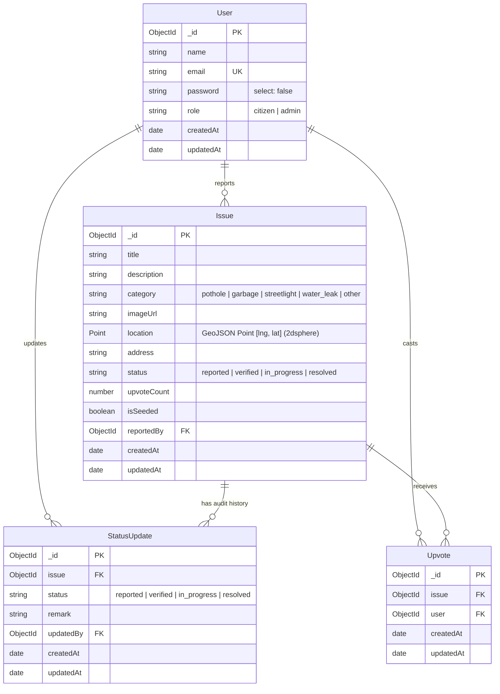

# CivicFix — Bengaluru Civic Issue Reporting & Triage Platform

[](https://nodejs.org/)
[](https://react.dev/)
[](https://www.mongodb.com/)
[](https://opensource.org/licenses/ISC)

> **Live Demo**: [https://civicfix.vercel.app](https://civicfix.vercel.app) *(Placeholder)*  
> **API Base URL**: [https://civicfix-api.onrender.com/api](https://civicfix-api.onrender.com/api) *(Placeholder)*

CivicFix is a modern, full-stack civic issue reporting and municipal workflow management platform tailored for the city of **Bengaluru**. It empowers citizens to pinpoint urban infrastructure problems (potholes, overflowing garbage, broken streetlights, water pipeline leaks) using interactive Leaflet maps, Cloudinary photo uploads, and community upvotes. Municipal administrators triage issues using real-time geospatial duplicate detection, linear state machine workflows, thermal hotspot heatmaps, and MongoDB aggregation analytics.

---

## Key Features

- **Geospatial Issue Reporting**:
  - Interactive Leaflet map with OpenStreetMap tiles and custom GPS pin placement.
  - One-click HTML5 geolocation ("Use my current location").
  - Throttled OpenStreetMap Nominatim search bounded to the Bengaluru metropolitan region with automatic reverse geocoding.
- **Geospatial Duplicate Detection (`$near`)**:
  - Automatically queries within 50–500m of a chosen location on MongoDB `2dsphere` indexes to warn citizens of existing active reports before submission.
- **Cloudinary Image Upload**:
  - Memory-buffered streaming upload (zero temporary files written to server disk).
- **Linear Status Workflow State Machine**:
  - Strict forward progression: `reported` $\rightarrow$ `verified` $\rightarrow$ `in_progress` $\rightarrow$ `resolved`.
  - Immutable audit trail (`StatusUpdate` collection) recording timestamps, administrative remarks, and user identities.
- **Community Upvotes & Starvation-Free Priority Algorithm**:
  - Atomic `$inc` toggles with MongoDB compound unique indexes preventing race conditions.
  - Dynamic score formula on read combining category severity weight, community upvotes, and age (capped at 30 days):
    $$\text{Priority} = (\text{Weight} \times 10) + (\text{Upvotes} \times 2) + \min(\text{AgeInDays}, 30)$$
- **Hotspot Heatmap Visualization**:
  - Dynamic `leaflet.heat` thermal layer weighted by normalized priority intensity, highlighting urgent neighborhood clusters while excluding resolved issues.
- **Administrative Analytics Dashboard**:
  - MongoDB aggregation pipelines calculating category distribution, status breakdowns, 30-day activity trends (with zero-filled days), and average resolution hours.
  - Interactive Recharts bar, donut, and line charts.
- **Hardened Security**:
  - Helmet HTTP security headers.
  - Rate limiting on `/api/auth` (20 requests per 15 minutes per IP).
  - Bcrypt password hashing with `select: false` on Mongoose schemas.
  - Role-based authorization (`citizen` vs `admin`) and resource ownership verification.
  - Global React `ErrorBoundary` and responsive UI down to 375px mobile screens.

---

## Tech Stack

| Tier | Technologies |
| :--- | :--- |
| **Frontend** | React 18, Vite, React Router v6, Axios, Leaflet, React-Leaflet, Leaflet.heat, Recharts, Plain Modular CSS |
| **Backend** | Node.js, Express 4, Mongoose 8, JWT, Bcrypt.js, Multer (Memory Storage), Helmet, Express-Rate-Limit |
| **Database** | MongoDB Atlas (2dsphere geospatial indexing, compound unique constraints, aggregation pipelines) |
| **Media / Cloud** | Cloudinary API (Buffered Stream Uploads), OpenStreetMap Nominatim API |
| **Testing** | Jest, Supertest, Mongo-Memory-Server |
| **Deployment** | Render (Web Service), Vercel (SPA with URL Rewrites) |

---

## Architecture Diagram



---

## Data Model (Entity-Relationship Diagram)



---

## Project Folder Structure

```
civicfix/
├── DEPLOYMENT.md              # Deployment guide for Render & Vercel
├── README.md                  # Project documentation & viva guide
├── client/                    # React frontend (Vite)
│   ├── .env.example           # Frontend environment template
│   ├── index.html             # HTML entry template
│   ├── package.json           # Client scripts & dependencies
│   ├── vercel.json            # Vercel SPA routing rewrite rules
│   ├── vite.config.js         # Vite bundler configuration
│   └── src/
│       ├── main.jsx           # React DOM root entry
│       ├── App.jsx            # Top-level routing & layout
│       ├── index.css          # Unified custom responsive styling
│       ├── api/
│       │   ├── axios.js       # Axios client with JWT interceptor
│       │   └── geocode.js     # OSM Nominatim search & reverse geocoding
│       ├── context/
│       │   └── AuthContext.jsx# Global authentication provider
│       ├── components/
│       │   ├── ErrorBoundary.jsx # Global render error catcher
│       │   ├── HeatmapLayer.jsx  # Leaflet.heat map layer
│       │   ├── IssueCard.jsx     # Card listing item with upvote button
│       │   ├── LocationPicker.jsx# Map coordinate picker with geolocation
│       │   ├── Navbar.jsx        # Navigation bar
│       │   ├── ProtectedRoute.jsx# Auth & role route guard
│       │   ├── StatusBadge.jsx   # Color-coded workflow badge
│       │   └── UpvoteButton.jsx  # Atomic toggle upvote control
│       └── pages/
│           ├── AdminDashboard.jsx# Triage table & Recharts analytics
│           ├── Dashboard.jsx     # Citizen profile & reported issues
│           ├── Home.jsx          # Landing page & feature highlights
│           ├── IssueDetail.jsx   # Issue details, mini map & timeline
│           ├── Login.jsx         # Citizen & Admin login
│           ├── MapView.jsx       # Public map (Pins & Hotspot Heatmap)
│           ├── NotFound.jsx      # 404 handler
│           ├── Register.jsx      # Citizen sign-up
│           └── ReportIssue.jsx   # Issue submission form with duplicate checks
└── server/                    # Node.js Express backend
    ├── .env.example           # Backend environment template
    ├── package.json           # Server scripts & dependencies
    ├── server.js              # Express app bootstrap & route registration
    ├── config/
    │   ├── cloudinary.js      # Cloudinary v2 SDK configuration
    │   └── db.js              # MongoDB Mongoose connection
    ├── controllers/
    │   ├── adminController.js # Aggregation pipelines for analytics
    │   ├── authController.js  # Registration, login, profile fetch
    │   └── issueController.js # Issue CRUD, nearby search, status, upvotes
    ├── middleware/
    │   ├── authMiddleware.js  # JWT protect & adminOnly guards
    │   ├── errorMiddleware.js # 404 notFound & centralized errorHandler
    │   └── uploadMiddleware.js# Multer memory storage & MIME filter
    ├── models/
    │   ├── Issue.js           # Issue schema with 2dsphere index
    │   ├── StatusUpdate.js    # Workflow transition audit log schema
    │   ├── Upvote.js          # Unique compound index {issue, user}
    │   └── User.js            # User schema with bcrypt password hashing
    ├── routes/
    │   ├── adminRoutes.js     # /api/admin/stats
    │   ├── authRoutes.js      # /api/auth (register, login, me)
    │   └── issueRoutes.js     # /api/issues routes
    ├── scripts/
    │   ├── createAdmin.js     # Seeds default administrative user
    │   └── seedData.js        # Seeds 80 realistic Bengaluru issues & hotspots
    └── utils/
        ├── priority.js        # Starvation-free priority calculation
        ├── statusFlow.js      # Linear status transition state machine
        └── uploadToCloudinary.js # Buffer stream to Cloudinary folder
```

---

## Setup & Local Installation

### Prerequisites
- Node.js (v18 or higher)
- A running MongoDB Atlas instance or local MongoDB
- A free [Cloudinary](https://cloudinary.com/) account (Cloud Name, API Key, API Secret)

### 1. Clone the Repository
```bash
git clone https://github.com/your-username/civicfix.git
cd civicfix
```

### 2. Configure Backend
```bash
cd server
npm install
```

Copy `.env.example` to `.env` and fill in your values:
```env
PORT=5000
NODE_ENV=development
MONGO_URI=mongodb+srv://<user>:<password>@cluster.mongodb.net/civicfix?retryWrites=true&w=majority
JWT_SECRET=your_super_secret_jwt_key
CLIENT_URL=http://localhost:5173
ADMIN_EMAIL=admin@civicfix.org
ADMIN_PASSWORD=Admin@12345
CLOUDINARY_CLOUD_NAME=your_cloud_name
CLOUDINARY_API_KEY=your_api_key
CLOUDINARY_API_SECRET=your_api_secret
```

Seed the default Admin user and demo dataset:
```bash
# Seed initial administrator
npm run seed:admin

# Seed 80 demo issues across Bengaluru with hotspots and upvotes
npm run seed:data
```

Start the backend development server:
```bash
npm run dev
```

### 3. Configure Frontend
Open a new terminal:
```bash
cd client
npm install
```

Create `client/.env`:
```env
VITE_API_URL=http://localhost:5000/api
```

Start the Vite development server:
```bash
npm run dev
```

Visit `http://localhost:5173` in your browser.

---

## API Endpoints Reference

| Method | Endpoint | Access | Description |
| :--- | :--- | :--- | :--- |
| **GET** | `/api/health` | Public | Server uptime and health verification |
| **POST** | `/api/auth/register` | Public (Rate-limited) | Register a new citizen account |
| **POST** | `/api/auth/login` | Public (Rate-limited) | Authenticate and receive a JWT |
| **GET** | `/api/auth/me` | Protected | Fetch authenticated user profile |
| **GET** | `/api/issues` | Public | List issues (supports `?category=`, `?status=`, `?sort=priority`) |
| **GET** | `/api/issues/mine` | Protected | List issues reported by the current citizen |
| **GET** | `/api/issues/nearby` | Public | Spatial `$near` query (`?latitude=&longitude=&radius=&category=`) |
| **GET** | `/api/issues/:id` | Public | Get single issue details (optional auth for `hasUpvoted`) |
| **POST** | `/api/issues` | Protected | Report issue (`multipart/form-data` with optional `image`) |
| **DELETE**| `/api/issues/:id` | Protected (Owner/Admin) | Delete a reported civic issue |
| **GET** | `/api/issues/:id/history` | Public | Fetch chronological audit trail timeline |
| **PATCH**| `/api/issues/:id/status` | Admin Only | Advance workflow status (`verified`, `in_progress`, `resolved`) |
| **POST** | `/api/issues/:id/upvote` | Protected | Toggle atomic community upvote (cannot upvote own issue) |
| **GET** | `/api/admin/stats` | Admin Only | MongoDB aggregation analytics (categories, status, 30-day timeline) |

---

## Automated Tests

Backend automated integration tests use **Jest**, **Supertest**, and **mongodb-memory-server** to execute in-memory tests without touching the live MongoDB Atlas database.

```bash
cd server
npm test
```

Tests cover:
- Citizen registration and login validation.
- Role elevation protection (verifies `role` cannot be set to `admin` on registration).
- Authentication guard enforcement (401 on missing or invalid JWT).
- Role access restrictions (citizens receive 403 Forbidden on `/api/issues/:id/status`).
- Linear status state machine validation (invalid status transitions return 400).
- Geospatial `$near` queries on 2dsphere index (`/api/issues/nearby`).

---

## Application Screenshots

| Public Map & Hotspots | Issue Reporting & Pin Picking |
| :---: | :---: |
| *(Placeholder: Public Map with Heatmap Toggle)* | *(Placeholder: Leaflet Location Picker with Nominatim)* |

| Issue Details & Workflow Timeline | Admin Dashboard & Analytics |
| :---: | :---: |
| *(Placeholder: Issue Detail with Status Audit Log)* | *(Placeholder: Recharts Operational Dashboard & Triage Table)* |
